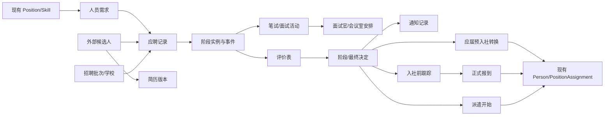

# 招聘管理扩展系统设计（整合评审版）

> 状态：已确认基线；本期实现范围按最新确认修订
> 整理日期：2026-10-10
> 对应需求：`recruitment-management-requirements.md`
> 本文用于指导本期模型和系统实现。

## 1. 设计原则

1. 外部候选人与内部 `Person` 分离，在各招聘类型规定的时点显式转换并建立关联。
2. 候选人主档、简历版本和应聘流程分离，支持同一人多次投递和跨期追踪。
3. 流程状态只保存当前值，所有变化在适用保留期内另存不可覆盖的事件记录。
4. 评价模板版本化，历史评价不随模板变化。
5. 个人评价、阶段决定和最终决定分离，避免汇总结论覆盖原始意见。
6. 排程活动由人事担当人工录入；冲突检查、自动改期和 MS365 同步属于后续阶段。
7. 邮件采用“事务内写入待发送记录、异步发送并回写结果”，避免异步失败无记录。
8. 重复检测只辅助人事，不自动拒绝候选人；趋势分析属于后续阶段。
9. 招聘敏感数据采用独立业务权限和访问审计。
10. 新模型通过新增 Liquibase 变更演进，不修改已执行的历史 changeset。

## 2. 领域关系



## 3. 核心数据模型

以下名称为设计阶段名称，代码实现前仍可调整。

### 3.1 RecruitmentRequisition（人员需求）

主要字段包括唯一需求编号、招聘类型、年度/期间、部门、需求人数、期望到岗日、优先级、理由、招聘生命周期、编辑状态、当前版本号、招聘期间，以及关联的 `Position` 和提出人。

业务部门相关人员和人事担当在 `EDITABLE` 状态下可以共同修改。人事担当锁定后成为 `LOCKED` 的定版需求；只有 `ACTIVE + LOCKED` 可以接收新应聘。已有关联应聘时不得物理删除。

### 3.2 RequisitionVersion / RequisitionEditEvent（需求版本与编辑事件）

`RequisitionVersion` 保存每次人事定版时的不可变需求快照、版本号、锁定人和锁定时间。`RequisitionEditEvent` 保存解锁、重新锁定和关键修改事件，包括操作人、时间和原因。

需求不设置审批轮次或认可/驳回结论。解锁权限属于人事担当；解锁后已有应聘继续引用原版本，新应聘需等待重新锁定。

`RecruitmentRequisitionMember` 保存人员需求、用户、成员类型（`BUSINESS_EDITOR` 或 `BUSINESS_VIEWER`）、有效状态及添加/移除审计。业务人员必须同时具有 `ROLE_BUSINESS_RECRUITER` 和有效成员记录才能访问对应需求；编辑者也只能在需求为 `EDITABLE` 时修改。人事担当不依赖成员记录访问招聘业务数据。

### 3.3 RecruitmentBatch（招聘批次）

保存批次编码、名称、招聘类型、学校、期间、报名截止日、计划笔试时间、状态、负责人，并关联一个或多个人员需求。学校首期保存名称，后续需要主数据治理时再提取 `School` 实体。

### 3.4 ExternalCandidate（外部候选人）

保存身份、联系方式、教育/工作摘要、候选人状态、已转换 `Person` 引用及创建修改审计。候选人不直接保存“当前招聘阶段”，因为同一人可能存在多个应聘记录。

### 3.5 CandidateResume（简历版本）

保存候选人、版本号、接收时间、原文件名、媒体类型、文件大小、SHA-256、存储键、结构化摘要、有效版本标记和上传审计。文件摘要参与保留期内的重复检测，但在到期删除时与文件及候选人资料一并删除。

首期采用受控服务器文件目录保存文件，数据库只保存元数据和不可猜测的存储键，不保存 BLOB 或服务器绝对路径。存储根目录通过部署配置指定，且必须位于 Web 静态资源目录之外；下载只能通过应用服务完成权限校验、审计记录和流式响应。

定义统一 `RecruitmentFileStorage` 接口，至少提供保存、读取、存在性检查和删除能力。本地实现使用系统生成的存储键组织目录，不使用候选人姓名或原文件名作为物理路径。上传先写临时文件，完成大小和 SHA-256 校验后再原子移动到正式位置；数据库事务失败时清理新文件，删除任务失败时保留可重试状态。未来迁移对象存储时保持业务实体和下载接口不变。

### 3.6 PartnerOrganization / RecruitmentSourceRecord（合作公司与来源记录）

`PartnerOrganization` 保存合作公司编码、名称、启用状态和可配置的合作角色，例如中介、派遣公司或招聘网站运营方，并保存是否启用派遣接收/转正观察流程及默认观察期限。

`RecruitmentSourceRecord` 保存来源类别、合作公司、补充说明、推荐人、接收时间及关联候选人/应聘。来源类别、合作公司和具体来源说明分离。INFINIX 只作为 `PartnerOrganization` 数据，不进入枚举或代码分支。

来源类别首期为 `CAMPUS_RECRUITMENT`、`AGENCY`、`JOB_SITE` 和 `EMPLOYEE_REFERRAL`。服务端校验应届可以使用全部四类，中途采用只能使用 `AGENCY` 或 `JOB_SITE`；具体学校、网站、合作公司和推荐人按来源类别校验必填关系。

### 3.7 RecruitmentApplication（应聘记录）

保存应聘编号、候选人、人员需求、可选批次、招聘类型、当前阶段、状态、使用的简历版本、申请/关闭时间、关闭原因、最终决定、转换后的 `Person`、保留截止日和保留处理状态。未转换人员的 `retentionUntil` 按 `closedAt + 5 年` 计算；流程重新打开时重新计算，避免在有效招聘处理中删除资料。

不采用简单的 `(candidate, requisition)` 唯一约束，以支持撤回后重新投递等真实情况；重复检测负责提示。

### 3.8 ApplicationStage（阶段实例）

保存应聘、阶段类型、顺序、状态、开始/完成时间、入选结果、决定人/时间/意见及评价模板版本。首期选考阶段类型：

- `RESUME_SCREENING`；
- `WRITTEN_TEST`；
- `FIRST_INTERVIEW`；
- `SECOND_INTERVIEW`；
- `FINAL_INTERVIEW`。

阶段实例使选考流程按招聘类型配置，避免把所有阶段做成应聘记录的固定字段。最终结果、通知、入社前跟踪、报到和派遣观察分别由 `HiringDecision`、`NotificationMessage`、`PreboardingFollowUp`、人员转换事件和 `DispatchAssignment` 表达，不与选考阶段重复建模。

### 3.9 ApplicationEvent（流程事件）

保存应聘、可选阶段、事件类型、原/新状态、操作用户、发生时间、理由和扩展元数据。这是在适用保留期内进行审计和流程时间分析的事实来源，普通用户不能编辑或删除；到期删除规则优先于事件留存。

### 3.10 SelectionActivity（选考活动）

统一表示笔试和各轮面试，保存活动类型、应聘、阶段、带时区的起止时间、场地、会议室、状态、排程版本、日历提供方、外部事件 ID、同步状态和变更原因。

本期由人事担当人工录入并维护确定的时间、场地和面试官。系统不检查排期冲突，不自动改期或重新安排；需要变更时由人事担当线下协调后更新记录并发送通知。自动冲突检查、改期历史和 MS365 同步留待后续阶段。

### 3.11 ActivityParticipant（活动参与者）

保存活动、参与者类型、关联的用户/人员/候选人、场内角色、出席状态和是否通知。人事担当人工确定活动参与者并录入系统；本期服务端不执行时间冲突检查。

各招聘类型和面试轮次都不预设固定面试官构成。人事担当根据候选人和业务方向逐场添加、移除或更换面试官，每次变化进入排程历史并触发必要通知。

### 3.12 MeetingRoom（会议室）

保存会议室编码、名称、位置、容量和启用状态。人事担当人工录入会议室安排；本期不执行会议室占用冲突检查，不保存外部日历同步字段。

### 3.13 WrittenTestResult（笔试结果）

保存应聘、活动、考试类型版本、时长、原始/标准化分数、结果、意见、评分人/时间和草稿/提交/发布状态。

中途采用仍创建笔试结果，但流程配置将其设为一次面试现场活动的前置任务，不将它作为独立淘汰关口。

### 3.14 评价模板

采用 `EvaluationTemplate`、`EvaluationTemplateVersion` 和 `EvaluationCriterion` 三层模型。模板版本保存适用招聘类型/阶段、生效期间、总分规则和发布状态；评价项保存统一维度编码、名称、说明、顺序、权重、必填、答题类型、选项/分数范围及是否进入横向比较。

发布后的版本不可修改，调整必须创建新版本。

### 3.15 RecruitmentEvaluation / EvaluationAnswer

评价主表保存应聘、阶段、活动、模板版本、实际评价人、系统录入人、录入方式、状态、总体推荐、总分、标准化分、总结、实际评定时间及提交/发布时间。答案保存对应评价项的分数、选择或文本值。

一个面试官一份独立评价。阶段汇总由 `StageDecision` 保存。

一般面试官直接录入时，实际评价人和系统录入人相同；经营层最终面试采用 `RECORDED_BY_HR` 录入方式，由人事担当根据经营层评定整理录入，实际评价人指向经营层人员。提交后作为正式结果记录，更正时创建更正版本并在适用保留期内保留原内容。

评价读取由服务端按“参与场次、评价提交状态、发布范围和用户角色”联合授权。前序阶段汇总结论可以在本人评价提交前查看；前序或同阶段的个人详细评价在本人提交前不可见，提交后仍需命中明确授权。人事担当拥有招聘评价全量视图，业务部门相关人员默认只读取已发布的阶段汇总；经营层评定人可以读取其评定对象的全部招聘资料和评价。

### 3.16 StageDecision / HiringDecision

`StageDecision` 保存是否进入下一阶段及理由。`HiringDecision` 保存最终结果、结果来源、登记人、登记时间、意见和依据版本。通用结果为 `HIRED`、`NOT_HIRED`、`RESERVE`、`WITHDRAWN`；允许派遣的合作方增加 `ACCEPT_AS_DISPATCHED`。

应届 `HiringDecision` 的来源为 `EXTERNAL_APPROVAL_RESULT`，由人事担当在系统外审批完成后登记；系统不保存审批步骤或审批参与人。中途采用的来源为 `EXECUTIVE_FINAL_INTERVIEW`。

最终决定更正采用新版本并使旧版本失效，不做原地覆盖。

### 3.17 应届系统外审批边界

不设计 `HiringApproval` 实体或审批阶段。二次面试评价和结果发布完成后，应聘状态进入 `SELECTION_COMPLETED`。外部审批完成后，人事担当登记 `HiringDecision`；若结果为 `HIRED`，界面显示“转换为正式员工”动作。

### 3.18 ResultPublication（结果发布）

关联笔试结果、评价、阶段决定或最终决定，保存发布人/时间、接收用户或角色、发布版本、是否要求确认、确认期限及确认状态。发布决定系统内可见范围，通知负责告知接收者，两者分离。个人详细评价和阶段汇总使用不同的发布对象及授权范围。

普通阶段结果默认 `ackRequired=false`，以消息发送状态和访问审计证明周知；录用决定等重要事件可以配置 `ackRequired=true`。需要确认时另存每个接收人的确认时间并生成逾期提醒。未确认本身不撤销发布结果，只有事件规则明确要求时才阻止后续转换。

### 3.19 NotificationRule / NotificationTemplate / NotificationMessage

`NotificationRule` 按业务事件和招聘类型保存启用状态、发送方式（`MANUAL_CONFIRM` 或 `AUTO_AFTER_COMMIT`）、默认模板和最大重试次数。`NotificationRuleRecipient` 保存收件人选择器和 `TO/CC` 类型；选择器首期支持 `CANDIDATE`、活动参与者角色、需求成员、人事负责人、指定内部角色和指定用户。

`NotificationTemplate` 按事件、语言和版本保存主题、纯文本正文、允许变量及发布状态。发布后的模板版本不可修改；候选人模板使用独立的对外变量白名单，不能引用个人原始评价、内部意见或其他候选人信息。

`NotificationMessage` 保存业务来源、规则、模板版本、渲染后的最终主题和正文、发送方式、发送状态、尝试次数、最后错误、创建/确认/发送用户和时间。发送状态首期使用 `WAITING_CONFIRMATION`、`PENDING`、`SENDING`、`SENT`、`FAILED` 和 `CANCELLED`。`NotificationRecipient` 固化每次消息解析后的实际邮箱、内部用户或候选人引用以及 `TO/CC` 类型，保证配置后续变化不改写历史消息。

业务事务对人工确认规则创建 `WAITING_CONFIRMATION` 消息，对自动规则创建 `PENDING` 消息；人工确认后才转为 `PENDING`。后台任务只领取 `PENDING` 消息，先以原子状态更新或锁定方式转为 `SENDING`，再发送并回写 `SENT` 或 `FAILED`。消息通过唯一业务键避免同一业务事件和规则重复生成。

首期启用候选人和内部人员邮件。候选人邮件默认使用 `MANUAL_CONFIRM`：人事可以在发送前预览并调整本次主题、正文和收件人，确认后才进入 `PENDING`。内部通知可按事件配置为自动发送；自动模式仍保存最终渲染内容和收件人快照。候选人没有有效邮箱时不创建 `PENDING` 消息，改为生成待人工联络提示并记录处理结果。

### 3.20 PreboardingFollowUp（到岗前跟踪）

保存计划/实际联系时间、担当、联系方式、结果、候选人意愿、风险等级、问题、下一行动和下次联系日，可关联现有 `ActionItem`。

### 3.21 DispatchAssignment / DispatchReview

派遣记录关联启用了派遣能力的 `PartnerOrganization`，保存工作部门/职位、开始/预计结束日、负责人和状态；观察记录保存每次评价、是否延长及转正建议。服务端只有在来源合作公司启用派遣流程时才允许最终结果为 `ACCEPT_AS_DISPATCHED`。

派遣人员在实际开始工作时创建并关联唯一 `Person`，雇佣形态为 `DISPATCHED`。正式转正时更新同一人员为 `REGULAR`，并追加雇佣形态历史；派遣延长或结束也写入 `DispatchReview` 和雇佣历史，不创建第二个人员档案。

### 3.22 DuplicateCandidateAlert（重复预警）

保存新旧候选人/简历/应聘引用、匹配规则、置信级别、脱敏匹配依据、处理状态、处理人/时间和结论。

### 3.23 RecruitmentAlert（业务预警）

统一承载超时、缺评价、通知失败、跟踪到期等本期业务预警。排程冲突预警属于后续阶段。可转为现有 `ActionItem`，并保存来源类型、来源 ID、严重度、首次/最后发现时间和解决状态。

### 3.24 RecruitmentDataDeletionLog（招聘资料删除记录）

未转换为 `Person` 的候选人资料从应聘关闭日起保留 5 年。定时任务按候选人汇总全部应聘，只有全部应聘均关闭且最晚的 `retentionUntil` 已到期时，才按外键依赖顺序删除通知内容、评价、阶段与活动记录、重复预警识别依据、应聘记录、结构化简历、原始文件和候选人主档。

已转换为正式或派遣 `Person` 的招聘资料进入员工长期参考资料，不进入该自动删除任务。删除任务只留下独立的 `RecruitmentDataDeletionLog`，保存不可反查个人身份的批次号、删除时间、执行主体、删除对象数量、文件删除结果和任务结果；日志不得保存候选人 ID、姓名、联系方式、文件摘要或原文片段。

定时任务按配置周期扫描到期资料并执行清理，任务结果以不包含个人身份信息的批次记录保存。文件和数据库删除需要具备幂等性；任一步骤失败时保留任务状态并产生预警，重试成功前不得把对象标记为已删除。到期数据从在线备份自然轮换退出，不能通过业务恢复功能重新导入。派遣人员观察期间及结束后的人员跟踪归入员工长期跟踪资料，不受候选人资料清理任务影响。

## 4. 预置流程

首期采用“流程定义 + 阶段定义”，但只允许管理员使用系统预置流程，暂不开发通用工作流设计器。

### 4.1 应届毕业生

| 顺序 | 阶段         | 淘汰关口 | 主要产出                         |
| ---- | ------------ | -------- | -------------------------------- |
| 1    | 简历预审     | 是       | 简历评价、笔试入选决定           |
| 2    | 笔试         | 是       | 分数、结果、一次面试入选决定     |
| 3    | 一次面试     | 是       | 独立评价、汇总结论、二次入选决定 |
| 4    | 二次面试     | 是       | 独立评价、汇总结论               |
| 5    | 选考处理结束 | 否       | `SELECTION_COMPLETED`            |
| 6    | 最终结果登记 | 否       | 人事登记系统外审批结果           |
| 7    | 人员转换     | 否       | 录用者的 `Person`                |
| 8    | 入社前跟踪   | 否       | 跟踪记录、风险预警               |
| 9    | 报到         | 否       | 激活人员及任职关系               |

### 4.2 中途采用

| 顺序 | 阶段                | 淘汰关口 | 主要产出                             |
| ---- | ------------------- | -------- | ------------------------------------ |
| 1    | 简历评价            | 是       | 面试入选决定                         |
| 2    | 现场笔试 + 一次面试 | 是       | 笔试结果、面试评价、最终面试入选决定 |
| 3    | 经营层最终面试      | 是       | 最终评价和决定                       |
| 4    | 通知                | 否       | 最终通知内容及处理/发送记录          |
| 5A   | 正式录用入社前跟踪  | 否       | 跟踪记录和风险预警                   |
| 6A   | 正式报到及人员转换  | 否       | `REGULAR + ACTIVE` 的 `Person`       |
| 5B   | 派遣开始及人员转换  | 否       | `DISPATCHED + ACTIVE` 的 `Person`    |
| 6B   | 派遣观察及最终处理  | 否       | 转正、延长或结束记录                 |

经营层最终面试结果由人事担当代录，分别保存经营层实际评定人和人事录入人。该阶段完成时同时形成最终评价和 `HiringDecision`，不进入 `HiringApproval`。

## 5. 状态控制

状态转换集中在领域服务实现，REST 层不得直接保存任意 DTO 状态。关键校验包括：

`RecruitmentApplication.status` 只表达应聘流程生命周期，阶段位置和最终结果分别由 `ApplicationStage` 与 `HiringDecision` 表达：

```text
IN_PROGRESS ↔ ON_HOLD
IN_PROGRESS → SELECTION_COMPLETED → DECIDED   （应届）
IN_PROGRESS ─────────────────────→ DECIDED   （中途）
DECIDED → CLOSED
```

`SELECTION_COMPLETED` 表示应届系统内二次面试及结果发布已经结束、正在等待系统外结果；`DECIDED` 表示已经存在有效的最终决定。非录用结果在完成必要通知后关闭；录用、派遣接收或候补记录在跟踪、报到、派遣开始、撤回或人工终结后关闭。人员转换通过 `convertedPerson/convertedAt` 表达，不另造与 `Person.employmentLifecycleStatus` 重复的应聘状态。重开 `CLOSED` 应聘时必须记录理由、清除 `closedAt/retentionUntil` 并创建事件，不覆盖既有决定版本。

`ApplicationStage.status` 首期使用 `NOT_STARTED`、`IN_PROGRESS`、`COMPLETED`、`SKIPPED` 和 `CANCELLED`。跳过或取消阶段必须填写原因；当前阶段由未完成阶段顺序计算，应聘记录上的 `currentStage` 只作为受控冗余字段维护。

- 不是 `ACTIVE + LOCKED` 的需求不能创建新应聘；
- 简历预审未完成不能选入笔试/面试；
- 笔试结果未提交不能发布；
- 必填面试官评价未全部提交不能完成阶段汇总；
- 评价人未提交本人评价时，服务端禁止读取其他人的个人详细评价；
- 应届未由人事登记外部审批最终结果，或中途经营层最终决定尚未形成时，不能发布或生成正式结果通知；
- 应届应聘不是 `HIRED` 时不能执行正式员工转换；
- 中途正式录用应聘不是 `HIRED` 或尚未确认实际报到时，不能执行正式员工转换；
- 派遣应聘不是 `ACCEPT_AS_DISPATCHED` 或尚未开始工作时不能执行派遣人员转换；
- 已转换应聘不能再次转换；
- 跳过阶段、退回和重开必须填写理由并产生事件。

## 6. 排程（本期）

人事担当线下完成协调后，手工录入候选人、活动类型、时间、会议室/地点和面试官；系统保存排程并按配置向参与者发送邮件。本期不执行冲突检查，不提供自动改期或自动重新安排。变更由人事担当先行协调，再修改记录并发送更新通知；MS365 同步和排程冲突管理留待后续阶段。

## 7. 评价横向比较

- 同一模板版本按维度和总分直接比较；
- 同一模板不同版本，只有维度编码和量表兼容时比较标准化分；
- 不同模板通过统一维度编码聚合，否则只并列展示原始评价；
- 文本评价不自动转换为分数；
- 报表同时展示评价人数和缺失评价；
- 招聘类型、学校和来源等群体属性不作为个人自动淘汰评分项。

## 8. 重复检测与后续趋势分析

登记时同步检查邮箱、电话、姓名+出生日期和文件 SHA-256；后台计算姓名、学校/公司和联系方式的相似组合。每条预警保存规则版本，保证可解释。

阶段超时、评价逾期和派遣观察到期等本期预警采用明确规则。按来源/学校/部门的趋势统计、异常升降和转化率分析不在本期实现范围。

## 9. 与现有系统的结合

### 9.1 可直接复用

- `Position`、`Skill`、`SkillLevel`：需求及要求快照来源；
- `User`：面试官、人事担当和经营层登录身份；
- `Person`：已最终录用并转换的正式人员、已开始工作的派遣人员，以及可选面试官身份；
- `PositionAssignment`：正式人员的未来/当前任职关系和派遣开始后的有效任职关系；
- `ActionItem`：预警转行动和跟踪待办；
- `JavaMailSender` 与现有 JHipster 邮件配置：复用底层 SMTP 配置；招聘消息状态由新增发送网关管理。

### 9.2 不直接复用

- `CandidateProfile`：保留内部继任/培养画像语义；
- `Evaluation`：保留员工综合评价语义，招聘采用版本化模板新模型；
- `TrainingRecord`：不记录招聘笔试或面试；
- `StaffSubstitution`：不用于招聘候选人与职位匹配。

### 9.3 需要扩展

- 安全模型：增加招聘角色和资源级授权；
- 审计：现有业务实体多数没有继承 `AbstractAuditingEntity`，招聘新实体显式加入审计字段，不可变动作使用事件表；
- 邮件：在现有邮件基础设施外增加模板、消息记录、重试和业务幂等；现有 `MailService` 的异步 `void` 调用会在内部吞掉发送异常，不能直接作为消息状态依据，需要新增可返回发送结果的同步 `RecruitmentMailGateway`，由消息任务调用并记录成功或失败；
- `Person`：增加独立于现有 `EmploymentStatus` 的 `employmentType`，首期至少支持 `REGULAR` 和 `DISPATCHED`；
- 人员生命周期：增加 `employmentLifecycleStatus`，首期至少支持 `PREBOARDING`、`ACTIVE` 和 `ENDED`，避免未报到人员计入实际在岗人数；
- 雇佣历史：新增 `EmploymentTypeHistory`，保存人员、原/新雇佣形态、生效日、决定来源、原因和操作人；
- Dashboard：本期呈现待处理、逾期和到岗前风险；招聘趋势分析留待后续阶段。

现有 `Person` 要求 `personName`、`employmentStatus`、`mentorFlag` 和 `coreCandidateFlag` 非空，而 `employeeCode` 可以暂时为空。转换画面需要由人事确认现有能力成长状态，不能根据应届、中途或派遣类型自动推断；两个布尔标记未指定时按 `false` 初始化。现有 `PositionAssignment` 已有起止日期和 `active` 字段，可以承载应届预入社的未激活任职及报到后的激活操作。

### 9.4 权限模型

授权采用“系统角色 + 资源关系”联合判断，所有规则在服务层或方法级安全中实施：

| 系统权限                  | 资源条件                   | 数据与操作范围                                                              |
| ------------------------- | -------------------------- | --------------------------------------------------------------------------- |
| `ROLE_HR_RECRUITER`       | 无需成员关系               | 全部招聘业务资料；需求锁定/解锁、敏感文件、排程、结果、通知、跟踪和人员转换 |
| `ROLE_BUSINESS_RECRUITER` | 有效需求成员记录           | 对应需求；可编辑状态下按成员类型编辑；关联应聘的已发布阶段汇总              |
| `ROLE_INTERVIEWER`        | 有效活动参与者或评价任务   | 本人场次所需资料和本人评价；详细评价继续受提交状态及发布授权限制            |
| `ROLE_EXECUTIVE_REVIEWER` | 被指定为该应聘的最终评定人 | 该候选人的简历、笔试、全部招聘评价、阶段结论及最终结果                      |
| `ROLE_RECRUITMENT_ADMIN`  | 配置资源                   | 流程、模板、预警和权限配置；单独持有该角色不能读取候选人敏感资料            |
| `ROLE_ADMIN`              | 系统技术管理               | 用户和系统管理；单独持有该角色不能读取招聘敏感资料                          |

同一用户可以叠加角色，最终权限取满足资源条件的角色权限并集。业务成员被移除、面试官被更换或经营层评定分配被取消后，关系授权立即失效，但既有操作审计不删除。后端查询接口必须在数据库查询或服务层同时限制资源范围，不能先返回全量数据再依赖前端过滤。

## 10. 人员档案转换事务

转换由单一服务事务完成：锁定应聘并验证未转换；根据招聘类型和转换动作校验最终决定、实际报到/开始工作状态及必填信息；创建或按明确规则关联 `Person`；创建 `EmploymentTypeHistory` 和未来生效/当前生效的 `PositionAssignment`；写入候选人、应聘、人员的关联及转换事件；提交后触发后续待办。

三种转换入口采用同一事务骨架，但状态结果不同：

- 应届 `HIRED`：外部审批结果登记后可转换为 `REGULAR + PREBOARDING`，创建未来生效或未激活任职关系；
- 中途正式录用 `HIRED`：完成入社前跟踪并确认实际报到后转换为 `REGULAR + ACTIVE`，创建当前有效任职关系；
- 派遣接收 `ACCEPT_AS_DISPATCHED`：确认实际开始工作后转换为 `DISPATCHED + ACTIVE`，创建当前有效任职关系和派遣记录。

应届正式员工实际报到时，将同一人员从 `PREBOARDING` 更新为 `ACTIVE` 并激活任职关系。所有转换和报到操作都必须幂等。

派遣转正事务锁定现有人员和派遣记录，验证未结束且尚未转正，更新同一 `Person.employmentType=REGULAR`，关闭派遣记录并追加雇佣历史。该操作必须幂等，不能生成第二个 `Person`。

招聘评价只作为只读参考，不自动创建 `PersonSkill` 或技能等级。

## 11. 员工双维评价模型的初步影响

能力职级维度已经明确为“业务领域 × 该领域的能力水平”，与自然年龄、工龄、当前职位和报酬档位解耦。现有 `Evaluation` 无法表达这种可版本化的双维评价，建议后续单独设计：

- `CapabilityDomain`：业务/专业领域，可支持层级和启停；
- `CapabilityLevelFramework`：能力职级体系及适用期间；
- `CapabilityLevel`：体系内的等级、定义、可观察行为和证据要求；
- `PersonCapabilityGrade`：员工在某业务领域的职级、主/辅助领域标记、确认日期和有效期间；
- `CapabilityGradeAssessment`：职级评定过程、原职级、建议职级、确认职级、评价人和证据；
- `ContributionFramework`：某业务领域的贡献评价框架；
- `ContributionTemplateVersion`：框架在特定期间生效的不可变版本；
- `ContributionCriterion`：领域专用的贡献指标、证据要求、权重和计量方式；
- `ContributionAssessment`：员工在评价期间各指标的结果、证据和评价人；
- `EmployeeEvaluationCycle`：评价期间；
- `EmployeeEvaluationTemplateVersion`：期间标准；
- `EmployeeEvaluationResult`：能力职级和业务贡献的评价结果及证据；
- `RoleAssignment`：PM、部门管理等职责，可基于或扩展 `PositionAssignment`；
- `RewardRecommendation`：与职位分离的奖金/报酬建议及审批。

`Skill/PersonSkill` 继续表示颗粒度较细的具体能力，`CapabilityDomain/Level` 表示对一个业务领域整体能力水平的归纳。两者可以建立要求或证据关系，但不能把单项技能等级直接当成职级。

人员领域采用“一个主领域＋多个辅助领域”模式：

- 同一人员在同一业务领域同一时间只能存在一条有效职级记录；
- 同一人员同一时间最多存在一个有效主领域，其他有效领域均为辅助领域；
- 新人尚未完成评定时可以暂时没有主领域，但一旦确认能力领域就必须指定主领域；
- 主领域切换通过结束旧记录并创建新记录实现，不原地覆盖历史；
- 各领域独立评定和晋级，辅助领域的等级不随主领域变化；
- 数据库唯一约束负责人员/领域的有效记录，服务层负责“最多一个有效主领域”和历史切换事务。

年龄、工龄和入社时间不进入职级自动计算。PM 等职责由角色/任职关系表达，业务贡献和报酬建议分别评价。是否迁移或保留现有 `Evaluation`，需在职级体系和业务贡献标准明确后决定；现阶段不修改现有实体。

业务贡献采用“按业务领域配置模板”的方向，但目前不预设具体指标、统一等级或跨领域换算公式。模板发布后不可修改，新制度创建新版本并设置适用期间。将来如需跨领域比较，必须增加经业务认可的共同维度映射或标准化规则；没有映射时只展示各领域原始结果。

## 12. 建议实施阶段

1. 基础档案和需求定版：需求协作编辑、锁定版本、批次、候选人、简历、来源、精确重复检测。
2. 招聘流程和评价：应聘、状态机、笔试、模板版本、评价、阶段决定和结果发布。
3. 排程和通知：人工录入活动、参与者、会议室，配置模板并留存发送记录。
4. 录用后闭环（本期）：最终结果登记、到岗前跟踪、派遣观察/延期/转正/结束、人员档案转换及到期资料定时清理。
5. 后续扩展：排程冲突检查和自动调整、MS365、招聘趋势分析、候选人门户、完整访问审计和员工双维评价。

每阶段都补齐三语言文案、Liquibase、服务端状态校验、REST 集成测试和关键前端交互测试。

## 13. 评审结论与进入实现前的设计门槛

### 13.1 整合评审结论

| 审查主题         | 整合结论                                                                               |
| ---------------- | -------------------------------------------------------------------------------------- |
| 现有模型边界     | 外部候选人不复用内部 `CandidateProfile`；招聘评价不复用员工 `Evaluation`               |
| 需求治理         | 无审批链；协作编辑、人事锁定、必要时解锁并产生新版本                                   |
| 两类招聘流程     | 应届保留系统外录用审批边界；中途由经营层最终面试直接形成决定                           |
| 人员转换时点     | 应届录用后先转预入社；中途正式录用在报到时转换；派遣在开始工作时转换                   |
| 评价与共有       | 独立评价、阶段汇总和最终决定分离；提交前后按授权控制详细评价                           |
| 权限控制         | 系统角色与需求成员、场次参与者、最终评定对象关系联合授权                               |
| 邮件通知         | 候选人与内部人员均可接收；事件、收件人、模板、发送方式和重试策略配置化                 |
| 数据保留         | 未转换人员关闭后保留五年并物理删除；已转换人员作为员工长期参考资料                     |
| 附件存储         | 首期受控服务器目录，数据库保存元数据和存储键，通过抽象接口为对象存储迁移留边界         |
| 现有代码适配     | `Person` 需要新增雇佣形态与人员生命周期；现有 `EmploymentStatus` 继续表示能力/成长阶段 |
| 员工双维评价演进 | 与招聘扩展保持实体边界，待业务领域指标明确后独立设计，不阻塞招聘基础模块               |

### 13.2 招聘实现前仍需确认

1. 本整合版需求和设计的最终整体确认。

能力职级等级体系、各领域贡献指标、评价责任人及其与奖金流程的关系属于员工评价后续设计门槛，不作为招聘模块进入实现的前置条件。
